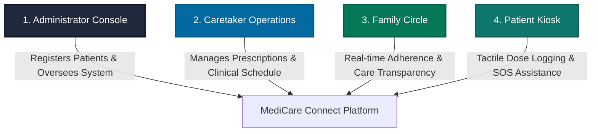
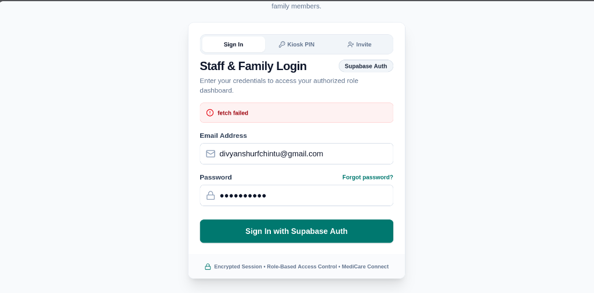
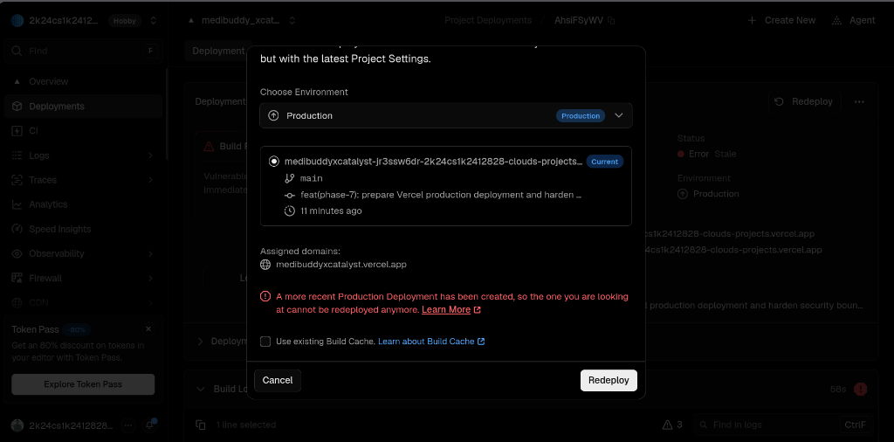
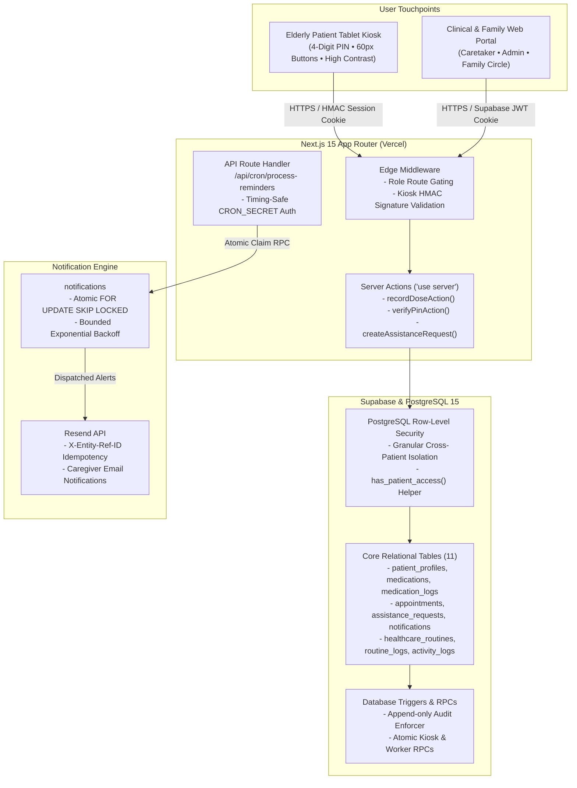

<p align="center">
  
</p>

# MediCare Connect

> **A collaborative healthcare platform designed to put elderly individuals at the center of medical decisions with dignity, high accessibility, and proactive care-circle coordination.**

[](https://medibuddyxcatalyst.vercel.app/)
[](https://nextjs.org/)
[](https://react.dev/)
[](https://www.typescriptlang.org/)
[](https://www.postgresql.org/)
[](https://supabase.com/)
[](https://resend.com/)
[](https://www.w3.org/WAI/standards-guidelines/wcag/)

---

## 🔗 Quick Navigation & Links

- **Live Application Deployment**: [https://medibuddyxcatalyst.vercel.app/](https://medibuddyxcatalyst.vercel.app/)
- **GitHub Repository**: [https://github.com/2k24cs1k2412828-cloud/medibuddy_xcatalyst](https://github.com/2k24cs1k2412828-cloud/medibuddy_xcatalyst)
- **Technical Documentation**:
  - [System Architecture](docs/ARCHITECTURE.md)
  - [Database Design & Schema](docs/DATABASE.md)
  - [Security Architecture & Threat Model](docs/SECURITY.md)
  - [Production Deployment Guide](docs/DEPLOYMENT.md)
  - [Contributing Guidelines](docs/CONTRIBUTING.md)
  - [Interface Screenshots](docs/screenshots/README.md)

---

## 📖 Overview

As elderly individuals manage multiple chronic conditions, daily healthcare routines quickly become overwhelming. Polypharmacy (taking 5+ daily prescriptions), fragmented communication between clinical caregivers and family members, and complex digital interfaces lead to missed doses, preventable hospital readmissions, and deep anxiety for loved ones.

**MediCare Connect** was engineered to solve this challenge through a human-centered, dignity-first paradigm. It unifies four key stakeholders—**Elderly Patients**, **Clinical Caretakers**, **Family Members**, and **Healthcare Administrators**—into a single, coordinated circle of care.

By combining an elderly-optimized tablet kiosk (4-digit PIN authentication, 20px+ high-contrast typography, and 60px tactile touch buttons) with automated dose logging, clinical skip rationales, emergency SOS alerts, and proactive transactional notifications via Resend, MediCare Connect ensures no patient is left behind in their own care decisions.

---

## ⚠️ Problem Statement

1. **Medication Non-Adherence**: Over 50% of elderly patients do not take chronic medications as prescribed due to complex schedules, forgetfulness, or confusing instructions.
2. **The "Silent Skip" Problem**: When an elderly patient skips a dose due to nausea or dizziness, care teams often remain unaware until severe clinical complications arise.
3. **Fragmented Family Visibility**: Adult children and family circles frequently suffer from care anxiety, lacking real-time visibility into whether daily medications were taken.
4. **Emergency Assistance Delays**: Traditional medical alert systems are often physically disconnected from the patient's daily medication and routine schedule.
5. **ePHI Security & Isolation**: Patient health data requires strict authorization, tenant isolation, and immutable clinical audit trails to prevent data leakage.

---

## 💡 The Solution & User Roles

MediCare Connect addresses these challenges by partitioning responsibilities into four distinct, strictly governed roles:



### Role Breakdown

| Role | Primary User | Core Responsibilities & Boundaries |
|---|---|---|
| **Administrator** | Clinical Director / System Admin | System-wide governance, patient onboarding, caregiver role assignment, and access to the tamper-proof append-only audit trail. |
| **Caretaker** | Registered Nurse / Clinical Aide | Manages prescriptions, reviews daily medication adherence across assigned patients, schedules clinical appointments, and resolves assistance requests. |
| **Family Member** | Adult Child / Relative / Guardian | Read-only visibility into their loved one's real-time adherence rate, scheduled appointments, and daily status to maintain peace-of-mind without clinical modification rights. |
| **Patient** | Elderly Individual | High-accessibility tablet kiosk interface. Logs scheduled doses as `TAKEN`, records `SKIPPED` doses with mandatory clinical reasons, acknowledges doctor appointments, and triggers immediate SOS assistance. |

---

## ✨ Key Features

- **Elderly-Accessible Kiosk Interface**: Frictionless 4-digit PIN authentication on shared family tablets, eliminating password fatigue. Includes 20px+ font scale, 60px tactile touch targets, and high color contrast designed following WCAG 2.1 accessibility guidelines.
- **Smart Medication & Dose Tracking**: Scheduled dose logs are generated automatically. Doses are **never automatically marked taken**—requiring genuine patient or caregiver verification.
- **Mandatory Clinical Skip Reasons**: Skipping a dose requires selecting a clinical rationale (e.g., *Nausea / Stomach Upset*, *Feeling Dizzy*, *Out of Medication*), immediately alerting caregivers.
- **Appointment Management & Patient Acknowledgment**: Caretakers schedule visits; patients acknowledge upcoming appointments with a single touch.
- **Emergency SOS & Assistance Requests**: One-touch urgent assistance requests instantly escalate with priority handling (`priority: 10`, 5 delivery attempts).
- **Proactive Transactional Reminders (Resend)**: Automated email reminders with atomic worker leasing (`FOR UPDATE SKIP LOCKED`), bounded exponential backoff, and idempotency headers (`X-Entity-Ref-ID`) to prevent duplicate dispatches.
- **Cryptographic Audit Trail**: Every sensitive action (dose logging, prescription changes, appointment updates, assistance resolutions) is appended to an immutable database audit log.

---

## 🖼️ Product Preview & Screenshots

Verified interface snapshots from the live application deployment:

| Staff & Family Supabase Login | Production Vercel Pipeline |
|---|---|
|  |  |
| *Unified Supabase Auth and Kiosk PIN Entry* | *Continuous Deployment & Security Verification* |

*Additional architectural diagrams and visual assets are located in [docs/screenshots/](docs/screenshots/).*

---

## 🛠️ Technology Stack

| Technology | Version | Purpose in Architecture |
|---|---|---|
| **Next.js** | `15.5.29` | React framework with App Router, Server Actions, and Route Handlers. |
| **React** | `19.0.0` | Modern UI library with concurrent React server/client components. |
| **TypeScript** | `5.x` | Strict static typing across all entities, actions, and API schemas. |
| **Tailwind CSS** | `4.x` | Design system styling optimized for accessible typography and ergonomics. |
| **Supabase** | `2.48.1` | PostgreSQL 15 database, Auth engine, and Row-Level Security policies. |
| **PostgreSQL** | `15` | Relational storage, composite indexes, stored procedures, and triggers. |
| **Resend** | `6.38.1` | Transactional email delivery service for medication & SOS alerts. |
| **Bcrypt.js** | `2.4.3` | Constant-time password and kiosk PIN hashing. |
| **Lucide React** | `0.475.0` | Accessible iconography system. |

---

## 🏗️ System Architecture



---

## 🗄️ Database Design

The database schema consists of **11 core relational tables** with strict constraints and foreign keys:

```text
users (id, email, role, full_name, created_at)
patient_profiles (id, full_name, date_of_birth, emergency_contact, kiosk_pin_hash, pin_failed_attempts, pin_locked_until)
patient_access (id, user_id, patient_id, access_level, is_active)
medications (id, patient_id, medication_name, dosage, frequency, time_of_day, is_active)
medication_logs (id, medication_id, patient_id, scheduled_time, action_time, status, skip_reason)
appointments (id, patient_id, caretaker_id, title, scheduled_time, status, location)
healthcare_routines (id, patient_id, title, routine_type, schedule_time, days_of_week, is_active)
routine_logs (id, routine_id, patient_id, scheduled_date, scheduled_time, status, completed_at)
assistance_requests (id, patient_id, urgency, message, status, resolved_by, resolved_at)
notifications (id, patient_id, recipient_email, event_type, status, delivery_attempts, worker_lease_until)
activity_logs (id, actor_id, actor_role, action, entity_type, entity_id, details, ip_address, created_at)
```

Detailed schema definitions, composite indexes, and SQL migrations are documented in [docs/DATABASE.md](docs/DATABASE.md).

---

## 📁 Project Structure

```text
catalyst_medibuddy/
├── docs/                               # Comprehensive project documentation
│   ├── ARCHITECTURE.md                 # Detailed architecture & sequence flows
│   ├── DATABASE.md                     # Schema definitions, ERD, and RLS policies
│   ├── SECURITY.md                     # Threat model, RBAC matrix, and headers
│   ├── DEPLOYMENT.md                   # Vercel setup & scheduler instructions
│   ├── CONTRIBUTING.md                 # Contribution workflow & coding standards
│   └── screenshots/                    # Verified interface preview screenshots
├── public/                             # Public static assets & OG social image
├── scripts/                            # Verification & automated test suites
│   ├── test_phase4_security.mjs        # RBAC, RLS, and Kiosk PIN lockout tests
│   ├── test_phase5_notifications.mjs   # Worker leases, retry backoff & Resend tests
│   └── test_phase6_e2e_integration.mjs # Full clinical workflow & E2E integration
├── src/
│   ├── app/                            # Next.js 15 App Router routes & layouts
│   │   ├── (auth)/login/page.tsx       # Unified Supabase Auth & Kiosk PIN login
│   │   ├── (dashboard)/                # Role-specific dashboard pages
│   │   │   ├── admin/page.tsx          # System Administrator console
│   │   │   ├── caretaker/page.tsx      # Caretaker clinical operations
│   │   │   ├── family/page.tsx         # Family circle adherence view
│   │   │   └── patient/page.tsx        # High-accessibility elderly patient kiosk
│   │   ├── api/cron/process-reminders/ # Secured scheduled notification worker
│   │   ├── layout.tsx                  # Root layout with SEO, canonical & OG tags
│   │   ├── page.tsx                    # Clinical platform overview landing page
│   │   ├── robots.ts                   # Search crawler directives
│   │   ├── sitemap.ts                  # Public sitemap generator
│   │   └── opengraph-image.tsx         # Dynamic @vercel/og social card
│   ├── components/                     # Reusable UI & dashboard components
│   │   ├── admin/                      # Administrator dashboard client
│   │   ├── auth/                       # Login and Kiosk keypad components
│   │   ├── caretaker/                  # Caretaker dashboard client
│   │   ├── family/                     # Family circle dashboard client
│   │   ├── layout/                     # AppHeader, AppSidebar, PageContainer
│   │   ├── patient/                    # Patient kiosk dashboard client
│   │   └── ui/                         # Base design system (Button, Card, Badge)
│   ├── lib/                            # Application logic & services
│   │   ├── actions/                    # Server Actions (Auth, Dose, Appointment)
│   │   ├── auth/                       # Kiosk session signing & validation
│   │   ├── email/                      # Resend service & HTML email templates
│   │   └── supabase/                   # Supabase client, server & admin SDKs
│   ├── middleware.ts                   # Edge middleware (Session & role gating)
│   └── types/                          # Shared TypeScript domain models
├── supabase/migrations/                # Numbered PostgreSQL migration files (001-009)
├── .env.example                        # Documented environment variable template
├── next.config.ts                      # Next.js configuration & HTTP security headers
├── package.json                        # Project dependencies and npm scripts
└── tsconfig.json                       # Strict TypeScript configuration
```

---

## 💻 Installation & Local Development

### Prerequisites
- Node.js `v20.x` or `v22.x LTS`
- npm `v10.x`+
- Git

### Quickstart

```bash
# 1. Clone the repository
git clone https://github.com/2k24cs1k2412828-cloud/medibuddy_xcatalyst.git
cd medibuddy_xcatalyst

# 2. Install dependencies
npm install

# 3. Configure local environment variables
cp .env.example .env.local
# Edit .env.local with your Supabase, Kiosk Secret, and Resend credentials

# 4. Start development server
npm run dev
```

Open [http://localhost:3000](http://localhost:3000) in your browser.

---

## 🔐 Environment Variables

The following environment variables are required for deployment. A clean template is provided in [.env.example](.env.example):

| Variable | Required In | Description |
|---|:---:|---|
| `NEXT_PUBLIC_SUPABASE_URL` | Public / Browser | Supabase project REST API endpoint URL. |
| `NEXT_PUBLIC_SUPABASE_PUBLISHABLE_KEY` | Public / Browser | Supabase anonymous API key for public sessions. |
| `SUPABASE_SERVICE_ROLE_KEY` | Server-Only | Privileged service key bypassing RLS for administrative operations. |
| `KIOSK_SESSION_SECRET` | Server-Only | 64-character high-entropy secret for HMAC-SHA256 kiosk tokens. |
| `CRON_SECRET` | Server-Only | Timing-safe Bearer token for `/api/cron/process-reminders`. |
| `RESEND_API_KEY` | Server-Only | API Key from Resend for transactional email notifications. |
| `RESEND_FROM_EMAIL` | Server-Only | Verified sender email address (e.g., `notifications@yourdomain.com`). |

---

## 🛡️ Security Architecture

MediCare Connect implements comprehensive technical safeguards:

1. **PostgreSQL Row-Level Security (RLS)**: Enforced directly at the database engine tier. Cross-patient data mutations and unassigned queries are rejected regardless of frontend state.
2. **Cryptographic Kiosk Passcode Protection**:
   - Patient PINs are stored as one-way Bcrypt hashes.
   - Evaluated using constant-time comparison in a database stored procedure.
   - Automated 5-attempt rate-limiting window triggers a mandatory 15-minute lockout state machine.
   - Kiosk sessions are signed with HMAC-SHA256 and verified using the Edge Web Crypto API.
3. **HTTP Defense-in-Depth Headers**: Configured across all application routes:
   - `X-Frame-Options: DENY`
   - `X-Content-Type-Options: nosniff`
   - `Referrer-Policy: strict-origin-when-cross-origin`
   - `Permissions-Policy: camera=(), microphone=(), geolocation=()`
   - Strict `Content-Security-Policy` restricting execution to `'self'` and Supabase endpoints.
   - `Strict-Transport-Security: max-age=63072000; includeSubDomains; preload`
4. **Immutable Clinical Audit Logs**: Audit log tables utilize PostgreSQL triggers that raise exceptions on `UPDATE` or `DELETE`, ensuring an indelible record of clinical actions.

---

## 🚀 Deployment

MediCare Connect is continuously deployed to **Vercel** with automated GitHub integration.

- **Production URL**: [https://medibuddyxcatalyst.vercel.app/](https://medibuddyxcatalyst.vercel.app/)
- **Deployment Guide**: For complete step-by-step instructions on setting up Vercel, Supabase, and external reminder schedulers (such as cron-job.org or Zeplo), refer to [docs/DEPLOYMENT.md](docs/DEPLOYMENT.md).

---

## 🧪 Testing & Validation

The codebase includes comprehensive automated test suites verifying all security boundaries, role permissions, notification worker concurrency, and WCAG 2.1 accessibility:

```bash
# 1. Run all 5 automated test suites (129 assertions)
npm test

# 2. Run strict TypeScript validation
npx tsc --noEmit

# 3. Run ESLint code quality checks
npm run lint

# 4. Execute Next.js production build
npm run build
```

Individual test suites can also be executed independently:

```bash
node scripts/test_phase4_security.mjs              # Security, RBAC & Kiosk Lockout (38 assertions)
node scripts/test_phase5_notifications.mjs         # Resend Email & Worker Leases (28 assertions)
node scripts/test_phase6_e2e_integration.mjs       # E2E Clinical Workflow & Integrity (39 assertions)
node scripts/test_phase7_advanced_edge_cases.mjs   # Advanced Edge Cases & Concurrency (10 assertions)
node scripts/test_phase8_accessibility.mjs         # Automated WCAG 2.1 Accessibility Audit (14 assertions)
```

**Overall Verification Status**: **129 of 129 automated assertions passing (100%)**.

---

## 🗺️ Roadmap (Planned Future Enhancements)

The following capabilities represent architectural enhancements planned for subsequent development phases:

- [ ] **Voice-Assisted Dose Confirmation**: Audio prompts and voice confirmation for visually impaired elderly patients.
- [ ] **Smart Pillbox IoT Integration**: Webhook receiver for Bluetooth/cellular smart pill dispensers to automatically sync physical dispenser openings with digital dose logs.
- [ ] **Offline-First PWA Synchronization**: Service Worker background sync for rural clinic kiosks experiencing intermittent internet connectivity.
- [ ] **FHIR / HL7 Interoperability Export**: Standardized clinical export formatting for seamless electronic health record (EHR) integration with hospitals.
- [ ] **Two-Way SMS Responses**: Allowing caregivers and family members to acknowledge missed dose notifications via direct SMS reply.

---

## 🤝 Contribution & License

- **Contributing**: Please review [docs/CONTRIBUTING.md](docs/CONTRIBUTING.md) for detailed coding conventions, accessibility requirements, and the pull request lifecycle.
- **License**: The repository currently has no declared open-source license. All rights are reserved by the authors for the hackathon evaluation and technical review.

---

## 🙏 Acknowledgements

MediCare Connect was developed as an innovation entry for:
- **CATALYST – Solo AI Hackathon**
- **Makers Need More (MnM)**
- **PromptWars**

*Special thanks to the open-source communities powering Next.js, Supabase, Tailwind CSS, and Lucide Icons for providing the building blocks for accessible digital healthcare.*
