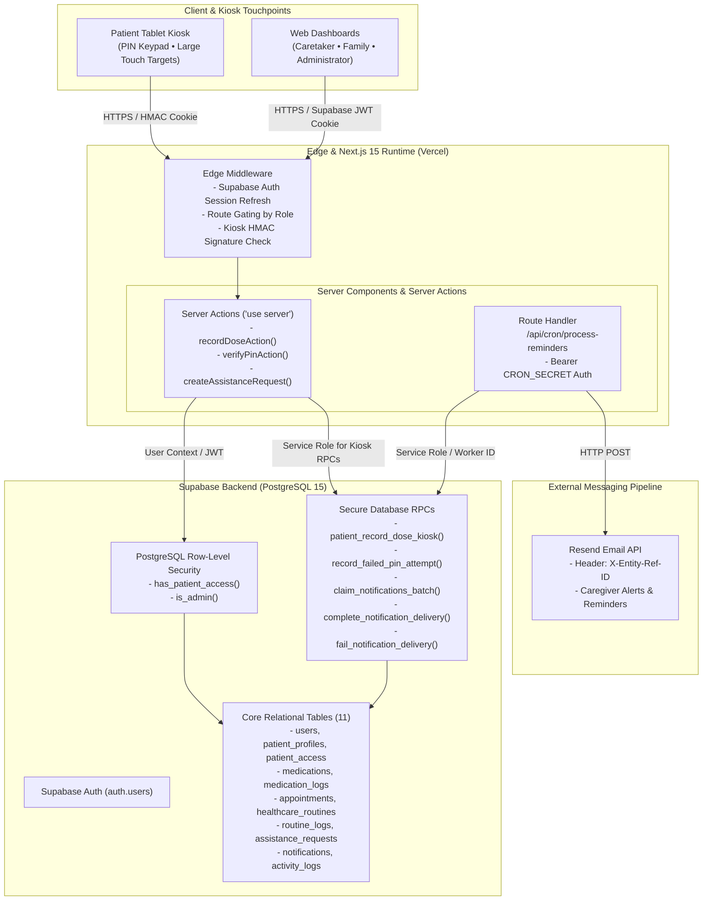
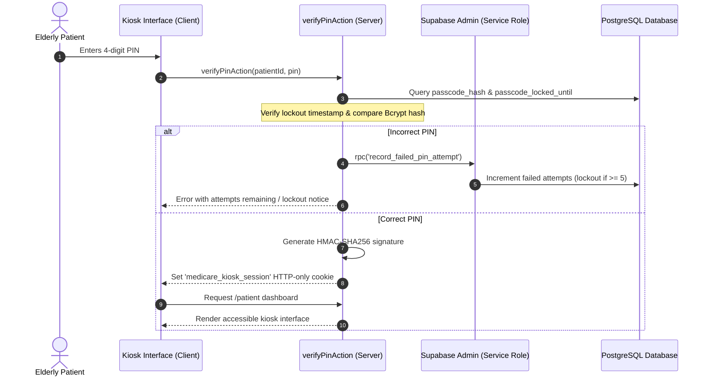

# MediCare Connect — Technical Architecture & System Specifications

## 1. System Overview

**MediCare Connect** is a collaborative, accessible healthcare platform designed for elderly care coordination. It connects four core stakeholders:
- **Elderly Patients**: Using an accessible tablet kiosk interface.
- **Clinical Caretakers**: Managing prescriptions, appointments, and care inquiries.
- **Family Circles**: Observing daily medication adherence and appointment status.
- **System Administrators**: Enrolling patients, assigning care teams, and reviewing audit trails.

The application is implemented using **Next.js 15 (App Router)** with **TypeScript**, a **Supabase (PostgreSQL 15)** database backend with Row-Level Security (RLS), and an asynchronous **Resend** email notification worker pipeline.

---

## 2. Core Architectural Principles

1. **Defense-in-Depth Authorization**: Route-level access is checked at the Edge via Next.js middleware, sensitive mutations are re-authorized inside Server Actions, and database access is constrained by PostgreSQL Row-Level Security (RLS) policies.
2. **Dual-Track Authentication Separation**:
   - **Staff & Family Users**: Authenticate through standard Supabase Auth (email/password), receiving Supabase JWT session cookies that directly satisfy PostgreSQL RLS.
   - **Elderly Patient Kiosk**: Authenticates via an on-screen numeric PIN verified against Bcrypt hashes in `patient_profiles.passcode_hash`. On success, the server issues an HMAC-SHA256 signed session cookie (`medicare_kiosk_session`).
   - *Architectural Boundary*: The Kiosk HMAC session cookie does **not** directly satisfy Supabase RLS. Instead, Next.js Server Actions verify the HMAC cookie on the server and invoke secure, server-only database RPC functions using the Supabase Service Role client.
3. **Immutable Clinical Auditing**: State changes (doses, appointments, assistance requests, access changes) are captured in `public.activity_logs`. Database triggers (`enforce_append_only_audit`) reject any `UPDATE` or `DELETE` operations on this table.
4. **At-Least-Once Notification Delivery**: Reminders are processed via an asynchronous queue with worker lease locking (`claim_notifications_batch`), stale lease recovery, bounded exponential backoff, and idempotency headers.

---

## 3. High-Level Architecture Diagram



---

## 4. Next.js 15 App Router Structure

The codebase adheres to the Next.js 15 App Router structure:

```
src/
├── app/
│   ├── (auth)/
│   │   └── login/page.tsx               # Unified Sign In, Kiosk PIN, and Invite tabs
│   ├── (dashboard)/
│   │   ├── admin/page.tsx               # System governance & audit trail
│   │   ├── caretaker/page.tsx           # Multi-patient management & prescriptions
│   │   ├── family/page.tsx              # Patient adherence overview & care contacts
│   │   └── patient/page.tsx             # Accessible elderly patient kiosk
│   ├── api/cron/process-reminders/
│   │   └── route.ts                     # Secured cron worker endpoint
│   ├── layout.tsx                       # Root layout with metadata and landmarks
│   ├── page.tsx                         # Landing page with workflow presentation
│   ├── robots.ts                        # Crawler directives (disallows private paths)
│   ├── sitemap.ts                       # Public sitemap generator
│   └── opengraph-image.tsx              # Dynamic Open Graph preview generator
├── components/
│   ├── admin/admin-dashboard-client.tsx
│   ├── auth/login-client.tsx
│   ├── caretaker/caretaker-dashboard-client.tsx
│   ├── family/family-dashboard-client.tsx
│   ├── layout/                          # AppHeader, AppSidebar, PageContainer
│   ├── patient/patient-dashboard-client.tsx
│   └── ui/                              # Button, Card, Badge, Input
├── lib/
│   ├── actions/                         # Server Actions (Auth, Medication, Patient, etc.)
│   ├── auth/                            # Kiosk HMAC signing, permissions, auth services
│   ├── email/                           # Resend integration, scheduler, and HTML templates
│   └── supabase/                        # Browser, server, and service-role clients
└── middleware.ts                        # Edge route gating and cookie refresh
```

---

## 5. Authentication & Authorization Lifecycle

### 1. Supabase Auth (Staff & Family)
- Handled by `src/lib/auth/auth.service.ts` via `supabase.auth.signInWithPassword`.
- Authenticated user records link to `public.users(id)` with roles: `ADMIN`, `CARETAKER`, `FAMILY`, or `PATIENT`.
- Session cookies are refreshed on each request inside `middleware.ts`.
- Direct Supabase queries in Server Components and Server Actions execute within the user's RLS security context.

### 2. Patient Kiosk Authentication (Numeric PIN)
- Patient PINs are stored as salted Bcrypt hashes in `public.patient_profiles.passcode_hash`.
- Validated via `verifyPatientPinAction` in `src/lib/auth/kiosk-session.ts`:
  1. Compares submitted PIN against the stored hash in constant time (`bcrypt.compareSync`).
  2. If incorrect, increments `failed_passcode_attempts` and invokes `record_failed_pin_attempt()`. After 5 consecutive failures, sets `passcode_locked_until = NOW() + INTERVAL '15 minutes'`.
  3. If valid, resets failed attempts and signs a token: `patientId:expiresAt:hmac_signature`.
  4. Sets the HTTP-only cookie `medicare_kiosk_session` with a 1-hour expiration.



---

## 6. Asynchronous Notification & Reminder Pipeline

The reminder engine operates an at-least-once scheduled delivery cycle:

```mermaid
flowchart TD
    Scheduler["External Scheduler (e.g., cron-job.org / GitHub Actions)
    Every 5 minutes"] -->|GET /api/cron/process-reminders
    Bearer CRON_SECRET| WorkerRoute["Route Handler
    src/app/api/cron/process-reminders/route.ts"]

    WorkerRoute --> ScheduleDue["scheduleDueReminders()
    - Scans medication_logs for upcoming/missed doses
    - Scans appointments for 24h reminders
    - Inserts PENDING into public.notifications"]

    ScheduleDue --> ClaimBatch["claim_notifications_batch(worker_id, 25)
    - Reclaims expired leases (status='CLAIMED' AND lease_expires_at < NOW())
    - SELECT ... FOR UPDATE SKIP LOCKED
    - Sets status='CLAIMED', lease_expires_at=NOW() + 2 mins"]

    ClaimBatch --> DispatchLoop["Sequential Notification Dispatch"]

    DispatchLoop --> SendEmail["sendEmailViaResend()
    - HTTP POST to Resend API
    - Header: X-Entity-Ref-ID = event_identifier"]

    SendEmail -->|Success (messageId)| CompleteRPC["complete_notification_delivery()
    - status = 'SENT'
    - external_id = messageId
    - sent_at = NOW()"]

    SendEmail -->|Provider Error / Timeout| FailRPC["fail_notification_delivery()
    - delivery_attempts += 1
    - next_retry_at = NOW() + (300s * 2^attempts)
    - If attempts >= max_attempts: status = 'FAILED'
    - Else: status = 'PENDING'"]
```

### Critical Notification Delivery Properties
- **Deduplication Key**: The database field `event_identifier` has a `UNIQUE` constraint (e.g., `event_upcoming_<dose_id>_<date>`), preventing duplicate rows from being inserted for the same event on the same day.
- **Provider Reference Header**: When dispatching to Resend, the `event_identifier` is transmitted in the `X-Entity-Ref-ID` header.
- **Worker Lease Duration**: Worker claims hold a 2-minute lease (`lease_expires_at`). If a worker terminates unexpectedly, subsequent batch claims automatically recover and reprocess stale records.
- **At-Least-Once Delivery**: Because a network failure could occur between Resend accepting the message and the database recording the completion, notifications may be re-delivered on failure recovery. Exactly-once delivery is not claimed.
