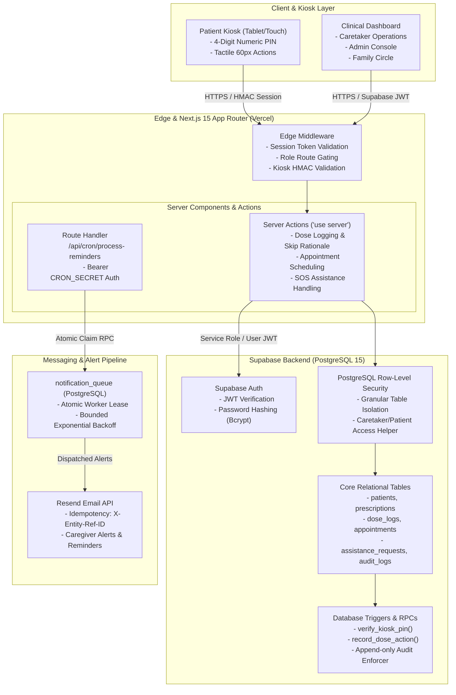
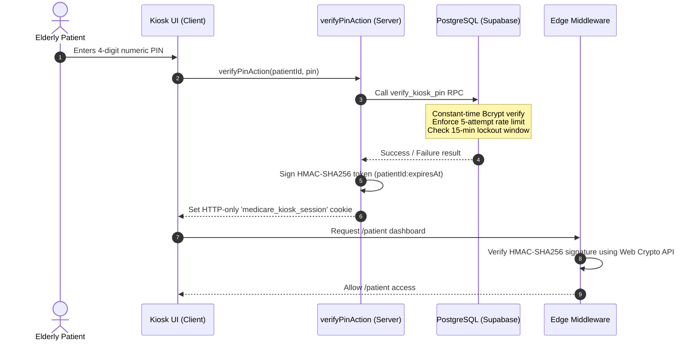

# MediCare Connect — System Architecture & Technical Specifications

## 1. System Overview

**MediCare Connect** is a collaborative, accessible healthcare platform architected specifically for elderly care ecosystems. It bridges the critical communication and adherence gap between **Elderly Patients**, **Clinical Caretakers**, **Family Members**, and **Healthcare Administrators**.

The application is built on **Next.js 15 (App Router)** with **TypeScript**, powered by a hardened **Supabase (PostgreSQL 15)** database backend, and orchestrated with an automated **Resend transactional email & notification worker engine**.

---

## 2. Architectural Principles

1. **Defense-in-Depth Security**: Every sensitive mutation is verified at multiple levels: Next.js middleware, authenticated Server Actions with input validation, and PostgreSQL Row-Level Security (RLS) enforcement at the storage tier.
2. **Elderly-First Accessibility**: The patient user interface departs from dense SaaS paradigms in favor of tactile ergonomics: 20px+ base typography, 60px tactile touch targets, 4-digit PIN authentication, and high-contrast color ratios exceeding 7:1 following WCAG 2.1 accessibility guidelines.
3. **Immutable Clinical Auditing**: Patient dose logs, assistance calls, and administrative access records utilize append-only database triggers (`PREVENT_UPDATE` and `PREVENT_DELETE`) to provide an tamper-proof clinical trail.
4. **Resilient Notification Delivery**: Notification dispatch follows an at-least-once model using database worker leases, bounded exponential backoff, and cryptographic idempotency keys (`X-Entity-Ref-ID`) to eliminate duplicate reminders.

---

## 3. High-Level Architecture Diagram



---

## 4. Next.js 15 App Router Structure

MediCare Connect leverages the Next.js 15 App Router with distinct architectural boundaries:

```
src/app/
├── (auth)/
│   └── login/                 # Unified Supabase Auth + Kiosk PIN entry
├── (dashboard)/
│   ├── admin/                 # Administrator system governance portal
│   ├── caretaker/             # Caretaker clinical operations console
│   ├── family/                # Family circle adherence & updates portal
│   └── patient/               # High-accessibility elderly patient kiosk
├── api/
│   └── cron/
│       └── process-reminders/ # Secured scheduled notification worker endpoint
├── layout.tsx                 # Root layout with global metadata, canonical, & OG tags
├── page.tsx                   # Public marketing & clinical overview landing page
├── robots.ts                  # Search crawler directives (disallows private routes)
├── sitemap.ts                 # Dynamic public sitemap generator
└── opengraph-image.tsx        # Dynamic @vercel/og social preview card generator
```

### Component Responsibility Separation
- **Server Components (Default)**: Perform initial data prefetching, static HTML streaming, and strict metadata rendering.
- **Client Components (`'use client'`)**: Confined to interactive UI terminals (e.g., numeric PIN keypad, quick dose confirmation toggles, modal dialogs).
- **Server Actions (`'use server'`)**: Self-contained RPC routines handling authentication, dose tracking, and patient assistance requests without exposing raw database queries to the client.

---

## 5. Security & Authentication Architecture

### 1. Dual-Track Authentication
- **Staff & Family Users**: Authenticate via Supabase Auth using email and passwords. Successful authentication produces standard secure HTTP-only session cookies.
- **Elderly Patient Kiosks**: Authenticate using an on-screen 4-digit PIN against Bcrypt password hashes stored in `patients.kiosk_pin_hash`. Upon validation, an HMAC-SHA256 signed cookie (`medicare_kiosk_session`) is issued with an explicit expiration timestamp.

### 2. Kiosk Session Cryptographic Verification


---

## 6. Notification & Reminder Pipeline

The reminder engine operates an at-least-once delivery cycle driven by scheduled worker executions:

1. **Trigger Phase**: The external scheduler triggers `GET /api/cron/process-reminders` accompanied by the `Authorization: Bearer <CRON_SECRET>` header.
2. **Claiming Phase**: Worker calls `claim_notifications(batch_size, lease_duration)` which uses `SELECT ... FOR UPDATE SKIP LOCKED` to atomically claim pending notifications without race conditions.
3. **Dispatch Phase**: Sends emails via Resend with the `X-Entity-Ref-ID` header set to the notification ID.
4. **Retry Timing Phase**: Unsuccessful attempts enter an exponential backoff sequence:
   - Attempt 1: 10 minutes (`5m * 2^1`)
   - Attempt 2: 20 minutes (`5m * 2^2`)
   - Attempt 3: 40 minutes (`5m * 2^3`)
   - Attempt 4: 80 minutes (`5m * 2^4`)
   - Max attempts reached (3 for routine, 5 for SOS) transitions status to `FAILED`.
