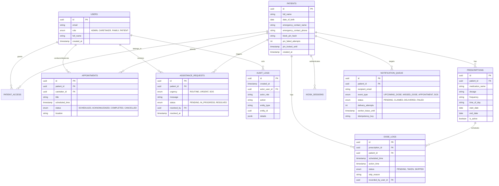

# MediCare Connect — Database Design & Schema Architecture

## 1. Relational Database Overview

MediCare Connect uses a relational PostgreSQL 15 database hosted on Supabase. The schema is normalized, indexed for high-volume adherence and notification throughput, and enforced at the database layer with Row-Level Security (RLS) policies and append-only audit triggers.

---

## 2. Entity-Relationship Diagram



---

## 3. Core Relational Tables (11 Total)

| Table Name | Primary Purpose | Key Constraints |
|---|---|---|
| `users` | Profiles extending Supabase `auth.users` with system role (`ADMIN`, `CARETAKER`, `FAMILY`, `PATIENT`). | Primary Key on `id`, email unique check. |
| `patients` | Elderly patient clinical entity, emergency contacts, and kiosk authentication credentials. | PIN hash storage, attempt counter, lockout timestamp. |
| `patient_access` | Caregiver and family circle authorization map binding users to specific patients. | Composite unique constraint `(user_id, patient_id)`. |
| `prescriptions` | Medication clinical orders, dosing instructions, active dates, and schedule rules. | FK to `patients(id)`. |
| `dose_logs` | Real-time scheduled and recorded dose events with mandatory skip reasons. | Check constraint: `SKIPPED` requires non-null `skip_reason`. |
| `appointments` | Clinic visits and medical appointments with patient acknowledgment state. | FKs to `patients(id)` and `users(id)`. |
| `assistance_requests`| Patient-initiated assistance tickets and emergency SOS signals. | Urgency categorization (`ROUTINE`, `URGENT`, `SOS`). |
| `kiosk_sessions` | Active and historical elderly kiosk tablet sessions. | Expiration timestamps and IP tracking. |
| `invitations` | Care circle invitation tokens for onboarded caregivers and family members. | High-entropy token, expiration check. |
| `audit_logs` | Immutable audit trail of every clinical action and state mutation. | Immutable triggers (`PREVENT_UPDATE`, `PREVENT_DELETE`). |
| `notification_queue`| Asynchronous transactional alert pipeline with worker leases. | Unique `idempotency_key` preventing duplicate dispatches. |

---

## 4. Row-Level Security (RLS) Implementation

RLS is enabled on every healthcare table. Access evaluation is handled by PostgreSQL security helper functions:

```sql
-- Helper: Checks whether current authenticated user has active access to a patient
CREATE OR REPLACE FUNCTION public.has_patient_access(target_patient_id uuid)
RETURNS boolean AS $$
BEGIN
  -- Administrators have universal oversight
  IF (SELECT current_user_role()) = 'ADMIN' THEN
    RETURN true;
  END IF;

  -- Caretakers and Family members must have explicit permission mapping
  RETURN EXISTS (
    SELECT 1 FROM public.patient_access
    WHERE user_id = auth.uid()
      AND patient_id = target_patient_id
      AND is_active = true
  );
END;
$$ LANGUAGE plpgsql SECURITY DEFINER;
```

### Table Policy Matrix
- **`patients`**: Caretakers/Family can `SELECT` assigned patients. Admins can `SELECT/INSERT/UPDATE`.
- **`prescriptions`**: Caretakers/Admins can `INSERT/UPDATE`. Patients/Family have read-only `SELECT`.
- **`dose_logs`**: Patients can update `status` for their own doses. Concurrent duplicate submissions on already completed doses are rejected.
- **`audit_logs`**: All roles can `INSERT` audit entries. `UPDATE` and `DELETE` operations are categorically rejected by database triggers.

---

## 5. Stored Procedures & Database RPCs

### 1. `verify_kiosk_pin(p_patient_id uuid, p_pin text)`
- Performs constant-time Bcrypt hash comparison (`crypt(p_pin, kiosk_pin_hash)`).
- Enforces an automated 5-attempt rate limiter.
- Automatically sets `pin_locked_until = NOW() + INTERVAL '15 minutes'` upon 5 consecutive failures.
- Granted strictly to the server-side `service_role`.

### 2. `record_dose_action(p_dose_id uuid, p_status text, p_skip_reason text)`
- Validates dose status transitions (`PENDING` -> `TAKEN` or `SKIPPED`).
- Rejects empty skip reasons for `SKIPPED` status.
- Atomically computes updated medication adherence percentages.

### 3. `claim_notifications(p_batch_size int, p_lease_seconds int)`
- Uses `FOR UPDATE SKIP LOCKED` to lock pending notifications.
- Assigns worker lease ownership preventing parallel worker race conditions.
