# MediCare Connect — Database Design & Schema Specifications

## 1. Database Architecture Overview

MediCare Connect uses a relational PostgreSQL 15 database hosted on Supabase. The database architecture enforces healthcare data integrity at the storage layer via:
- **11 Normalized Relational Tables** covering clinical profiles, medications, scheduled doses, routines, appointments, emergency tickets, notifications, and immutable audit logs.
- **PostgreSQL Row-Level Security (RLS)** active on every table, evaluating access based on authenticated user IDs and explicit permissions.
- **Automated Database Triggers & Stored Procedures (RPCs)** governing append-only audit enforcement, dose status validation, kiosk PIN lockout, and notification worker concurrency.

---

## 2. Entity-Relationship Diagram (ERD)

```mermaid
erDiagram
    USERS ||--o{ PATIENT_ACCESS : "grants access"
    USERS ||--o{ MEDICATIONS : "prescribes/creates"
    USERS ||--o{ MEDICATION_LOGS : "records"
    USERS ||--o{ APPOINTMENTS : "manages/conducts"
    USERS ||--o{ ASSISTANCE_REQUESTS : "resolves"
    USERS ||--o{ NOTIFICATIONS : "receives"
    USERS ||--o{ ACTIVITY_LOGS : "acts"

    PATIENT_PROFILES ||--o{ PATIENT_ACCESS : "has caregivers/family"
    PATIENT_PROFILES ||--o{ MEDICATIONS : "prescribed"
    PATIENT_PROFILES ||--o{ MEDICATION_LOGS : "logs doses"
    PATIENT_PROFILES ||--o{ APPOINTMENTS : "attends"
    PATIENT_PROFILES ||--o{ HEALTHCARE_ROUTINES : "tracks"
    PATIENT_PROFILES ||--o{ ROUTINE_LOGS : "logs routine"
    PATIENT_PROFILES ||--o{ ASSISTANCE_REQUESTS : "requests"
    PATIENT_PROFILES ||--o{ NOTIFICATIONS : "targeted in"
    PATIENT_PROFILES ||--o{ ACTIVITY_LOGS : "subject of"

    MEDICATIONS ||--o{ MEDICATION_LOGS : "schedules doses"
    HEALTHCARE_ROUTINES ||--o{ ROUTINE_LOGS : "records daily habit"

    USERS {
        uuid id PK
        text email UK
        text full_name
        text phone
        varchar role "ADMIN, CARETAKER, FAMILY, PATIENT"
        text avatar_url
        timestamptz created_at
        timestamptz updated_at
    }

    PATIENT_PROFILES {
        uuid id PK
        uuid user_id FK "optional link to users"
        text full_name
        date dob
        varchar gender "MALE, FEMALE, OTHER, PREFER_NOT_TO_SAY"
        varchar blood_group
        text emergency_contact_name
        text emergency_contact_phone
        text_array medical_conditions
        text_array allergies
        text passcode_hash "Bcrypt hash of numeric PIN"
        int failed_passcode_attempts
        timestamptz passcode_locked_until
        timestamptz last_failed_attempt_at
        varchar status "ACTIVE, ARCHIVED, INACTIVE"
        timestamptz created_at
        timestamptz updated_at
    }

    PATIENT_ACCESS {
        uuid id PK
        uuid patient_id FK
        uuid user_id FK
        varchar relationship "PRIMARY_CARETAKER, CARETAKER, FAMILY, DOCTOR, SELF"
        jsonb permissions "Granular flags"
        varchar status "ACTIVE, PENDING, REVOKED"
        timestamptz created_at
        timestamptz updated_at
    }

    MEDICATIONS {
        uuid id PK
        uuid patient_id FK
        text name
        text generic_name
        text dosage
        varchar form "TABLET, CAPSULE, SYRUP, INJECTION, INHALER, DROPS, PATCH, OTHER"
        text instructions
        varchar frequency_type "DAILY, INTERVAL_DAYS, SPECIFIC_WEEKDAYS, AS_NEEDED_PRN"
        jsonb frequency_config
        jsonb reminder_times
        varchar timezone
        date start_date
        date end_date
        boolean is_active
        uuid created_by FK
        timestamptz created_at
        timestamptz updated_at
    }

    MEDICATION_LOGS {
        uuid id PK
        uuid medication_id FK
        uuid patient_id FK
        text dose_event_id UK "Deterministic sha256 hash"
        timestamptz scheduled_time
        timestamptz actual_action_time
        varchar status "PENDING, TAKEN, MISSED, SKIPPED"
        varchar skip_reason "SIDE_EFFECTS, NAUSEA, FORGOT, FEELS_BETTER, MED_UNAVAILABLE, DOCTOR_ADVISED, OTHER"
        text notes
        uuid recorded_by FK
        varchar recorded_by_role "PATIENT, CARETAKER, FAMILY, SYSTEM"
        varchar timezone
        timestamptz created_at
        timestamptz updated_at
    }

    APPOINTMENTS {
        uuid id PK
        uuid patient_id FK
        text title
        text doctor_name
        text specialty
        text clinic_hospital
        text location_address
        timestamptz appointment_date
        text instructions
        varchar status "SCHEDULED, ACKNOWLEDGED, COMPLETED, CANCELLED"
        boolean assistance_requested
        text patient_notes
        uuid created_by FK
        timestamptz created_at
        timestamptz updated_at
    }

    HEALTHCARE_ROUTINES {
        uuid id PK
        uuid patient_id FK
        text title
        text description
        varchar category "HYDRATION, EXERCISE, DIET, WELLNESS, CUSTOM"
        time target_time
        varchar frequency "DAILY, WEEKDAYS, WEEKENDS, AS_NEEDED"
        boolean is_active
        uuid created_by FK
        timestamptz created_at
    }

    ROUTINE_LOGS {
        uuid id PK
        uuid routine_id FK
        uuid patient_id FK
        date log_date
        boolean completed
        timestamptz completed_at
        uuid recorded_by FK
        timestamptz created_at
    }

    ASSISTANCE_REQUESTS {
        uuid id PK
        uuid patient_id FK
        varchar category "MEDICATION_CLARIFICATION, UNAVAILABLE_MEDICINE, APPOINTMENT_HELP, SCHEDULE_CHANGE, EMERGENCY_HELP, GENERAL_CARE"
        varchar urgency "NORMAL, URGENT"
        text message
        varchar status "OPEN, ACKNOWLEDGED, RESOLVED"
        text resolution_notes
        uuid resolved_by FK
        timestamptz resolved_at
        timestamptz created_at
    }

    NOTIFICATIONS {
        uuid id PK
        text event_identifier UK "Deterministic sha256 key"
        varchar external_id "Resend message ID"
        text recipient_email
        uuid recipient_id FK
        uuid patient_id FK
        varchar notification_type "UPCOMING_DOSE, MISSED_DOSE, APPOINTMENT_REMINDER, ASSISTANCE_ALERT, SCHEDULE_CHANGE"
        text subject
        text message_snippet
        varchar status "PENDING, CLAIMED, SENT, FAILED"
        uuid claimed_by "Worker instance ID"
        timestamptz claimed_at
        timestamptz lease_expires_at "2-minute lease"
        int delivery_attempts
        int max_attempts
        timestamptz next_retry_at
        text error_log
        timestamptz sent_at
        timestamptz created_at
    }

    ACTIVITY_LOGS {
        uuid id PK
        varchar actor_type "USER, PATIENT, SYSTEM"
        uuid actor_user_id FK
        uuid actor_patient_id FK
        text actor_name
        varchar actor_role "ADMIN, CARETAKER, FAMILY, PATIENT, SYSTEM"
        uuid patient_id FK
        varchar entity_type "MEDICATION, DOSE, APPOINTMENT, ROUTINE, ASSISTANCE, ACCESS, AUTH, NOTIFICATION"
        uuid entity_id
        varchar action "CREATE, UPDATE, DELETE, STATUS_CHANGE, AUTH_ATTEMPT, LOCKOUT, PASSCODE_RESET, MANUAL_RETRY"
        jsonb details
        timestamptz created_at
    }
```

---

## 3. Schema Definitions & Table Specifications

### 1. `public.users`
Stores user profile attributes extending Supabase's internal `auth.users`:
- `id` (UUID, PK): Matches `auth.users.id` with `ON DELETE CASCADE`.
- `role` (VARCHAR): Restricted by check constraint: `ADMIN`, `CARETAKER`, `FAMILY`, `PATIENT`. Default: `CARETAKER`.

### 2. `public.patient_profiles`
The primary clinical entity representing an elderly individual:
- `passcode_hash` (TEXT): Salted Bcrypt hash of the numeric PIN.
- `failed_passcode_attempts` (INT): Counter tracking consecutive failed attempts.
- `passcode_locked_until` (TIMESTAMPTZ): Set to `NOW() + 15 minutes` after 5 consecutive failures.
- `status` (VARCHAR): `ACTIVE`, `ARCHIVED`, `INACTIVE`.

### 3. `public.patient_access`
The authorization junction connecting caregivers and family to patients:
- `relationship`: `PRIMARY_CARETAKER`, `CARETAKER`, `FAMILY`, `DOCTOR`, `SELF`.
- `permissions` (JSONB): Granular permission flags, including `can_manage_medications`, `can_manage_appointments`, `can_resolve_assistance`, and `can_view_audit`.
- Constraint `uq_patient_user_access`: Unique on `(patient_id, user_id)`.

### 4. `public.medications`
Clinical medication orders:
- `form`: `TABLET`, `CAPSULE`, `SYRUP`, `INJECTION`, `INHALER`, `DROPS`, `PATCH`, `OTHER`.
- `frequency_type`: `DAILY`, `INTERVAL_DAYS`, `SPECIFIC_WEEKDAYS`, `AS_NEEDED_PRN`.
- `reminder_times` (JSONB): Array of 24h times (e.g., `["08:00", "20:00"]`).

### 5. `public.medication_logs`
Scheduled and completed individual dose events:
- `dose_event_id` (TEXT, UNIQUE): Deterministic hash preventing duplicate dose schedules for a medication at a specific time.
- `status`: `PENDING`, `TAKEN`, `MISSED`, `SKIPPED`.
- `skip_reason`: `SIDE_EFFECTS`, `NAUSEA`, `FORGOT`, `FEELS_BETTER`, `MED_UNAVAILABLE`, `DOCTOR_ADVISED`, `OTHER`.
- *Database Trigger (`validate_dose_log_update`)*: Rejects updating an already completed (`TAKEN`/`SKIPPED`) dose and requires `skip_reason` when `status = 'SKIPPED'`.

### 6. `public.appointments`
Medical appointments and clinic consultations:
- `status`: `SCHEDULED`, `ACKNOWLEDGED`, `COMPLETED`, `CANCELLED`.
- *Database Trigger (`validate_appointment_update`)*: Rejects state transitions once an appointment is marked `COMPLETED` or `CANCELLED`.

### 7. `public.healthcare_routines` & 8. `public.routine_logs`
Tracks daily non-pharmacological health habits (hydration, walking, blood pressure monitoring):
- Constraint `uq_routine_patient_daily`: Unique on `(routine_id, patient_id, log_date)` ensuring one entry per routine per day.

### 9. `public.assistance_requests`
Patient-initiated help and emergency SOS tickets:
- `category`: `MEDICATION_CLARIFICATION`, `UNAVAILABLE_MEDICINE`, `APPOINTMENT_HELP`, `SCHEDULE_CHANGE`, `EMERGENCY_HELP`, `GENERAL_CARE`.
- `urgency`: `NORMAL`, `URGENT`.
- `status`: `OPEN`, `ACKNOWLEDGED`, `RESOLVED`.

### 10. `public.notifications`
Transactional outbound reminder queue:
- `event_identifier` (TEXT, UNIQUE): Deterministic idempotency key.
- `status`: `PENDING`, `CLAIMED`, `SENT`, `FAILED`.
- `claimed_by` (UUID) & `lease_expires_at` (TIMESTAMPTZ): 2-minute worker claim lease.
- `delivery_attempts` (INT) & `max_attempts` (INT): Default 3 for routine reminders, 5 for SOS.

### 11. `public.activity_logs`
Append-only clinical audit log:
- Tracks all mutations with actor attribution (`actor_type`, `actor_user_id`, `actor_patient_id`, `actor_role`).
- *Database Trigger (`enforce_append_only_audit`)*: Hard exception raised on any `UPDATE` or `DELETE` attempt.

---

## 4. Key Stored Procedures & Database RPCs

| RPC Function | Parameters | Security Mode | Purpose |
|---|---|---|---|
| `is_admin()` | None | `SECURITY DEFINER` | Returns `true` if current `auth.uid()` has `role = 'ADMIN'`. |
| `has_patient_access()` | `p_patient_id UUID, p_required_permission TEXT` | `SECURITY DEFINER` | Checks active permission mapping in `patient_access` for the current user. |
| `patient_record_dose_kiosk()` | `p_patient_id, p_dose_log_id, p_status, p_skip_reason, p_notes` | `SECURITY DEFINER` (Service Role) | Atomic dose recording for Kiosk users, verifying patient ownership and updating log status. |
| `record_failed_pin_attempt()` | `p_patient_id UUID` | `SECURITY DEFINER` (Service Role) | Increments failed attempts and triggers 15-minute lockout at 5 failures. |
| `unlock_patient_passcode()` | `p_patient_id UUID` | `SECURITY DEFINER` (Admin Only) | Resets failed counter and clears lockout timestamp. |
| `claim_notifications_batch()` | `p_worker_id UUID, p_limit INT` | `SECURITY DEFINER` (Service Role) | Sweeps expired leases, claims up to `limit` pending notifications with `FOR UPDATE SKIP LOCKED`. |
| `complete_notification_delivery()` | `p_notification_id, p_worker_id, p_external_id` | `SECURITY DEFINER` (Service Role) | Marks notification as `SENT` with the Resend provider message ID. |
| `fail_notification_delivery()` | `p_notification_id, p_worker_id, p_error_log` | `SECURITY DEFINER` (Service Role) | Increments delivery attempts and calculates exponential backoff (`300s * 2^attempts`). |

---

## 5. Row-Level Security (RLS) Policy Matrix

Every table has RLS enabled (`ALTER TABLE ... ENABLE ROW LEVEL SECURITY`). Policies evaluate access based on role and patient mapping:

| Table | SELECT Policy | INSERT Policy | UPDATE Policy | DELETE Policy |
|---|---|---|---|---|
| `users` | Own record OR `is_admin()` | Internal trigger on `auth.users` | Own record OR `is_admin()` | `is_admin()` |
| `patient_profiles` | Assigned caretakers/family via `has_patient_access()` OR `is_admin()` | `is_admin()` | Caretakers with `can_edit_profile` OR `is_admin()` | `is_admin()` |
| `patient_access` | Self record OR assigned patient caregivers OR `is_admin()` | `is_admin()` OR `can_manage_access` | `is_admin()` OR `can_manage_access` | `is_admin()` |
| `medications` | Assigned patient caregivers/family OR `is_admin()` | Caretakers with `can_manage_medications` OR `is_admin()` | Caretakers with `can_manage_medications` OR `is_admin()` | `is_admin()` |
| `medication_logs` | Assigned caregivers/family OR `is_admin()` | System trigger OR `is_admin()` | Assigned patient OR caretaker with `can_mark_doses` | `is_admin()` |
| `appointments` | Assigned caregivers/family OR `is_admin()` | Caretakers with `can_manage_appointments` OR `is_admin()` | Caretakers OR patient acknowledging appointment | `is_admin()` |
| `healthcare_routines`| Assigned caregivers/family OR `is_admin()` | Caretakers with `can_manage_routines` OR `is_admin()` | Caretakers with `can_manage_routines` OR `is_admin()` | `is_admin()` |
| `routine_logs` | Assigned caregivers/family OR `is_admin()` | Assigned patient OR caretaker | Assigned patient OR caretaker | `is_admin()` |
| `assistance_requests`| Assigned caregivers/family OR `is_admin()` | Assigned patient OR caretaker | Caretakers with `can_resolve_assistance` OR `is_admin()` | `is_admin()` |
| `notifications` | Privileged worker (Service Role) OR `is_admin()` | Service Role / Triggers | Service Role / Worker Lease | `is_admin()` |
| `activity_logs` | Users with `can_view_audit` for assigned patient OR `is_admin()` | Authenticated users & system triggers | **REJECTED** (Trigger raises exception) | **REJECTED** (Trigger raises exception) |
