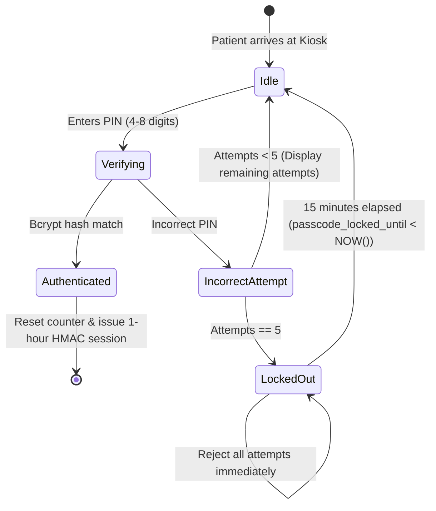

# MediCare Connect — Security Architecture & Threat Model

## 1. Security Overview & Boundary Notice

MediCare Connect implements defense-in-depth technical safeguards to protect sensitive healthcare workflows, patient records, and emergency alerts.

> [!IMPORTANT]
> **Regulatory & Compliance Notice**: This document describes the implemented technical safeguards, access boundaries, and threat mitigations. MediCare Connect has not undergone formal independent third-party HIPAA compliance audits, SOC 2 certification, or external penetration testing. These safeguards represent engineering best practices rather than legal certification. Fictional patient names (e.g., *Robert Chen*, *Margaret Taylor*) used in examples are synthetic test fixtures.

---

## 2. Threat Model & Mitigations

| Threat Vector | Attack Mechanism | Implemented Technical Mitigation |
|---|---|---|
| **Clickjacking** | Malicious third-party embedding the kiosk interface in an iframe. | `X-Frame-Options: DENY` and CSP directive `frame-ancestors 'none'` on all routes (`/:path*`). |
| **Session Forgery** | Tampering with client session state. | HMAC-SHA256 signature verification over `patientId:expiresAt` using Web Crypto API. Non-tamperable and time-bounded. |
| **Kiosk Brute-Force** | Scripted or manual guessing of the 4-digit patient PIN. | Constant-time Bcrypt hash comparison (`bcrypt.compareSync`), 5-attempt threshold, automated 15-minute lockout state machine (`passcode_locked_until`). |
| **Horizontal Privilege Escalation** | Caretaker or Family member attempting to view unassigned patient records. | PostgreSQL Row-Level Security (RLS) policies enforcing `has_patient_access(patient_id)` on every query. Server Actions independently re-verify patient access. |
| **Audit Trail Erasure** | Compromised user attempting to delete or alter dose history or assistance records. | Database trigger `enforce_append_only_audit` raises a hard PostgreSQL exception on any `UPDATE` or `DELETE` attempt against `public.activity_logs`. |
| **Unauthenticated Cron Invocations** | Malicious actor hitting `/api/cron/process-reminders` to trigger unauthorized dispatches. | Constant-time cryptographic verification of `Authorization: Bearer <CRON_SECRET>` (`crypto.timingSafeEqual`). Fails closed in production if secret is unconfigured. |
| **Credential Exposure** | Supabase service-role keys leaking into browser bundles. | Strict server-only isolation in `src/lib/supabase/admin.ts`. Runtime fail-closed check throws an immediate exception if accessed in client code. |
| **Concurrent Worker Collision** | Multiple scheduled worker executions simultaneously claiming the same reminders. | PostgreSQL row-locking via `claim_notifications_batch` using `FOR UPDATE SKIP LOCKED` and 2-minute worker leases. |

---

## 3. Dual-Track Authentication Architecture

A fundamental architectural distinction in MediCare Connect is the strict separation between **Supabase Auth** and **Patient Kiosk Authentication**:

```mermaid
flowchart TD
    subgraph TrackA["Track 1: Supabase Auth (Staff & Family)"]
        UserCredentials["Email + Password"] --> SupabaseAuth["Supabase Auth API"]
        SupabaseAuth --> JWT["HTTP-Only JWT Session Cookie"]
        JWT --> BrowserClient["Supabase SSR Client"]
        BrowserClient --> DirectRLS["PostgreSQL RLS
        - Evaluates auth.uid() directly
        - has_patient_access()"]
    end

    subgraph TrackB["Track 2: Kiosk Authentication (Elderly Patients)"]
        NumericPIN["4-Digit Numeric PIN"] --> VerifyAction["verifyPatientPinAction()
        - Server Action (Server-Side)"]
        VerifyAction --> BcryptCheck["Compare Bcrypt Hash in
        patient_profiles.passcode_hash"]
        BcryptCheck --> IssueCookie["Sign HMAC-SHA256 Token
        - Set medicare_kiosk_session Cookie"]
        IssueCookie --> ServerActionGuard["Server Action Layer
        - getTrustedActorContext()
        - Validates HMAC Signature"]
        ServerActionGuard --> PrivilegedRPC["Dedicated Database RPCs
        - patient_record_dose_kiosk()
        - Invoked via Service Role"]
    end
```



### Critical Separation Principle
The `medicare_kiosk_session` cookie **never** interacts directly with Supabase RLS. Supabase RLS expects an authenticated PostgreSQL role identified by `auth.uid()`. Because kiosk tablets do not maintain individual Supabase user accounts, patient actions are executed through **Server Actions** that:
1. Verify the kiosk session HMAC signature.
2. Ensure the session has not expired.
3. Validate that the action targets the authenticated `patientId`.
4. Invoke specific database stored procedures (`patient_record_dose_kiosk`) using the server-only `adminClient` holding the Supabase Service Role key.

---

## 4. Role-Based Access Control (RBAC) Matrix

| Resource / Action | Administrator | Caretaker | Family Member | Patient (Kiosk) |
|---|:---:|:---:|:---:|:---:|
| **Enroll New Patient Profile** | Allowed | Denied | Denied | Denied |
| **View Patient Profiles** | Universal | Assigned Only | Assigned Only | Self Only |
| **Prescribe / Edit Medications** | Allowed | Assigned Only | Denied | Denied |
| **Record Scheduled Dose as TAKEN** | Denied | Allowed (Clinical) | Denied | Allowed (Self) |
| **Record Scheduled Dose as SKIPPED**| Denied | Allowed (With Reason) | Denied | Allowed (With Reason) |
| **Schedule / Cancel Appointments** | Allowed | Allowed | Denied | Denied |
| **Acknowledge Appointments** | Allowed | Allowed | Allowed | Allowed |
| **Trigger Urgent SOS Alert** | Denied | Denied | Denied | Allowed |
| **Resolve Assistance Requests** | Allowed | Allowed | Denied | Denied |
| **View Activity / Audit Logs** | Full Trail | Assigned Patients | Assigned Patients | Denied |

---

## 5. Kiosk PIN Lockout State Machine



### Lockout Parameters
- **Maximum Consecutive Failures**: `5 attempts`
- **Lockout Duration**: `15 minutes` (`INTERVAL '15 minutes'`)
- **Database Tracking**: Recorded in `patient_profiles.failed_passcode_attempts` and `patient_profiles.passcode_locked_until`.
- **Administrative Override**: Administrators can call `unlock_patient_passcode(patient_id)` to clear the lockout timestamp and reset the attempt counter.

---

## 6. HTTP Defense-in-Depth Headers

Configured in [next.config.ts](file:///home/mayanksoni/Downloads/catalyst_medibuddy/next.config.ts) and applied universally across all routes (`/:path*`):

- **`X-Frame-Options: DENY`**: Prevents clickjacking by disabling embedding in external frames.
- **`X-Content-Type-Options: nosniff`**: Prevents MIME-confusion attacks.
- **`Referrer-Policy: strict-origin-when-cross-origin`**: Limits sensitive path leakage in referrer headers.
- **`Permissions-Policy: camera=(), microphone=(), geolocation=()`**: Restricts browser hardware access.
- **`Strict-Transport-Security: max-age=63072000; includeSubDomains; preload`**: Enforces strict HTTPS communication.
- **`Content-Security-Policy`**:
  ```text
  default-src 'self';
  script-src 'self' 'unsafe-eval' 'unsafe-inline';
  style-src 'self' 'unsafe-inline';
  img-src 'self' data: blob: https:;
  font-src 'self' data:;
  connect-src 'self' https://*.supabase.co wss://*.supabase.co;
  frame-ancestors 'none';
  base-uri 'self';
  form-action 'self';
  ```

---

## 7. Secret Management & Sensitive Data Hygiene

1. **Server-Only Boundaries**:
   - `SUPABASE_SERVICE_ROLE_KEY`: Read exclusively by `src/lib/supabase/admin.ts`. Throws a runtime error in production if missing.
   - `KIOSK_SESSION_SECRET`: Used exclusively by `src/lib/auth/kiosk-session.ts` and `src/middleware.ts` for HMAC signing and verification.
   - `CRON_SECRET`: Read exclusively by `src/app/api/cron/process-reminders/route.ts`.
   - `RESEND_API_KEY`: Read exclusively by `src/lib/email/resend.service.ts`.
2. **Logging Hygiene**:
   - Application logs never output plaintext PINs, session secrets, or full API keys.
   - Email templates exclude ICD-10 medical billing codes or diagnostic details.
