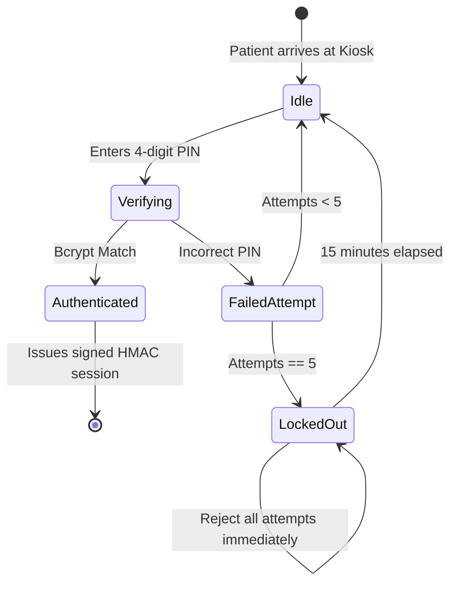

# MediCare Connect — Security Architecture & Threat Model

## 1. Security Overview & Compliance Alignment

MediCare Connect is engineered with defense-in-depth principles aligned with healthcare data governance requirements (such as HIPAA technical safeguards). All electronic Protected Health Information (ePHI)—including medication schedules, dose histories, and emergency assistance tickets—is protected through multi-layered controls.

> [!NOTE]
> MediCare Connect incorporates production-grade cryptographic and access controls. This documentation outlines architectural security implementation and does not claim a formal independent third-party certification.

---

## 2. Threat Model & Mitigations

| Threat Category | Potential Attack Vector | Applied Engineering Mitigation |
|---|---|---|
| **Clickjacking** | Malicious iframe embedding the patient kiosk to intercept touches or PINs. | `X-Frame-Options: DENY` and CSP `frame-ancestors 'none'`. |
| **Session Hijacking** | Stealing or forging authentication tokens. | HTTP-only, SameSite=Lax cookies, HMAC-SHA256 token signatures with strict expiration. |
| **Kiosk Brute-Force** | Rapidly guessing a patient's 4-digit PIN on a tablet. | Constant-time Bcrypt verification, 5-attempt threshold, automated 15-minute lockout state machine. |
| **Horizontal Escalation** | Caretaker or Family viewing or modifying unassigned patients. | PostgreSQL Row-Level Security (RLS) enforcing `has_patient_access()` on every query. |
| **Audit Log Tampering** | Malicious actor altering or erasing dose logs or records. | Append-only database triggers (`PREVENT_UPDATE`, `PREVENT_DELETE`) rejecting modifications. |
| **Denial of Service / Replay** | Spamming `/api/cron/process-reminders` to deplete API quota. | Constant-time cryptographic verification of `CRON_SECRET` Bearer token. |
| **Credential Leakage** | Leaking Supabase Service Role keys to browser bundles. | Strict server-only modules (`src/lib/supabase/admin.ts`), runtime fail-closed production guards. |

---

## 3. Role-Based Access Control (RBAC) Matrix

| Resource / Action | Administrator | Caretaker | Family Member | Patient (Kiosk) |
|---|:---:|:---:|:---:|:---:|
| **Register New Patient** | Allowed | Denied | Denied | Denied |
| **View Patient ePHI** | Universal | Assigned Only | Assigned Only | Self Only |
| **Prescribe Medication** | Allowed | Assigned Only | Denied | Denied |
| **Mark Dose TAKEN** | Denied | Allowed (Clinical) | Denied | Allowed (Self) |
| **Mark Dose SKIPPED** | Denied | Allowed (With Reason) | Denied | Allowed (With Reason) |
| **Schedule Appointment** | Allowed | Allowed | Denied | Denied |
| **Acknowledge Appointment**| Allowed | Allowed | Allowed | Allowed |
| **Trigger SOS Alert** | Denied | Denied | Denied | Allowed |
| **Resolve Assistance Ticket**| Allowed | Allowed | Denied | Denied |
| **View Audit Logs** | Full Trail | Patient-Scoped | Patient-Scoped | Denied |

---

## 4. Kiosk PIN Lockout State Machine

---

## 5. HTTP Security Headers & Content Security Policy (CSP)

The application enforces strict response headers configured in [next.config.ts](file:///home/mayanksoni/Downloads/catalyst_medibuddy/next.config.ts) for all routes (`/:path*`):

- **`X-Frame-Options: DENY`**: Categorically blocks iframe framing.
- **`X-Content-Type-Options: nosniff`**: Prevents browser MIME-type sniffing.
- **`Referrer-Policy: strict-origin-when-cross-origin`**: Limits referrer information leakage.
- **`Permissions-Policy: camera=(), microphone=(), geolocation=()`**: Disables unused browser hardware capabilities.
- **`Strict-Transport-Security: max-age=63072000; includeSubDomains; preload`**: Enforces HTTPS transport.
- **`Content-Security-Policy`**: Restricts resource execution to `'self'`, Supabase endpoints (`https://*.supabase.co`, `wss://*.supabase.co`), and prevents foreign form action submissions or script evaluation.

---

## 6. Secret Management

All sensitive secrets are isolated on the server side:
- `SUPABASE_SERVICE_ROLE_KEY`: Guarded with runtime checks throwing errors if accessed in client code.
- `KIOSK_SESSION_SECRET`: Lazily initialized on the server for HMAC-SHA256 signing.
- `CRON_SECRET`: Timing-safe Bearer token for triggering reminder workers.
- `RESEND_API_KEY`: Used exclusively by server-side email dispatch services.
