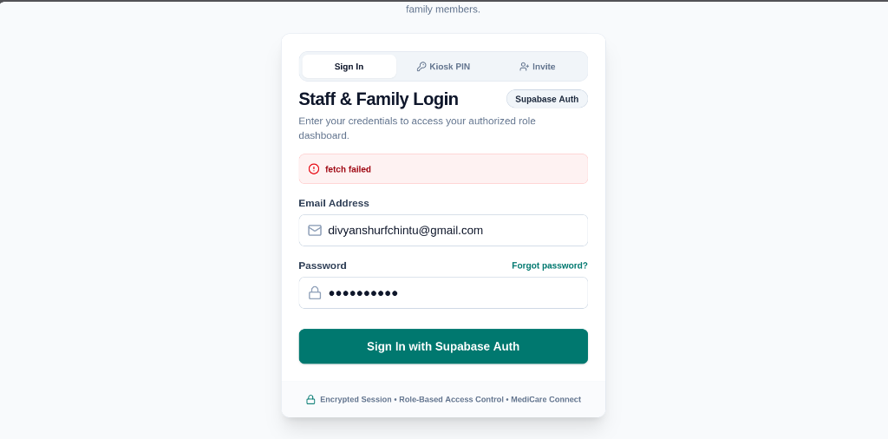
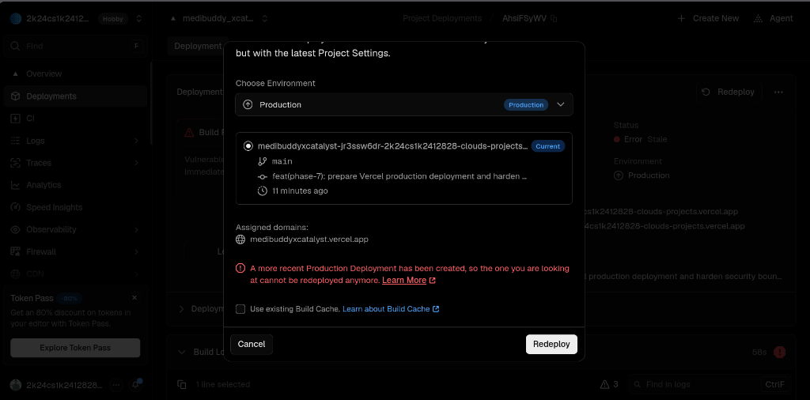
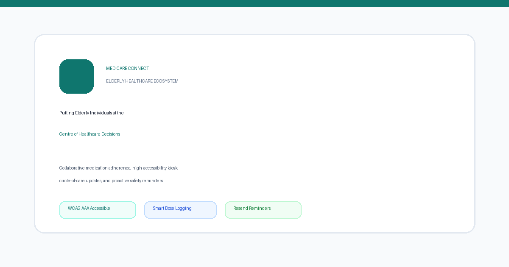

# MediCare Connect — Visual Interface Showcase

This directory contains verified interface previews and screenshots from the live MediCare Connect deployment (`https://medibuddyxcatalyst.vercel.app`).

## 1. Unified Authentication & Elderly Kiosk Access

*Features a dual-mode authentication card supporting clinical staff and family members via Supabase Auth, alongside an elderly-accessible 4-digit numeric keypad for tablet kiosk deployment.*

## 2. Production Vercel Deployment & Build Pipeline

*Automated continuous integration and deployment pipeline on Vercel with zero security blocks, Next.js 15 App Router static generation, and strict security header enforcement.*

## 3. Brand & Social Graph Preview

*High-resolution 1200x630 Open Graph card dynamically served for Twitter, LinkedIn, Slack, and messaging preview cards.*
