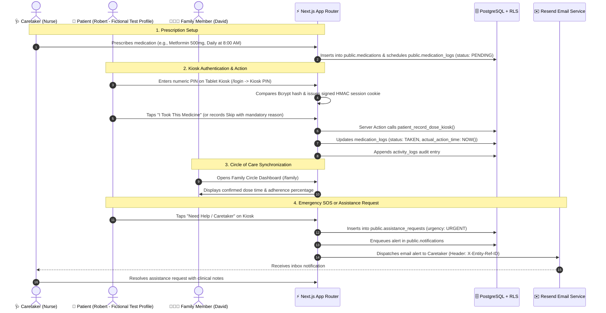

# MediCare Connect — Operational Workflow & User Guide

> **An operational guide explaining how MediCare Connect works, its core clinical workflows, and how each stakeholder (Patient, Caretaker, Family, Admin) interacts with the system.**

---

## 1. Product Overview & Purpose

**MediCare Connect** is a collaborative healthcare platform built to coordinate elderly care. It solves three critical everyday challenges:
1. **Medication Forgetfulness & Non-Adherence**: Polypharmacy (taking multiple daily medications) frequently leads to missed or confusing doses.
2. **The "Silent Skip" Problem**: Elderly patients who experience nausea or side effects often skip doses in silence. MediCare Connect requires a clinical skip reason so care teams can proactively follow up.
3. **Family Care Anxiety**: Loved ones living away from elderly parents lack visibility into whether critical medications were taken. MediCare Connect provides transparent, read-only adherence synchronization.

---

## 2. Core Workflows (How the System Operates)

The diagram below illustrates how data moves through MediCare Connect across the four roles:

---

## 3. The 4 Stakeholder Portals

---

### Portal 1: 👴 Patient Kiosk (`/patient`)
Designed specifically for tablets placed on a counter or bedside table:

- **Authentication**:
  1. Open `/login` and select the **"Kiosk PIN"** tab.
  2. Enter the patient's numeric PIN (configured via `patient_profiles.passcode_hash`).
  3. After successful verification, the server issues an HMAC-signed session cookie (`medicare_kiosk_session`).
- **Available Actions**:
  - **"I Took This Medicine"**: A prominent 64px green tactile button. Tapping it records the dose with a live timestamp.
  - **"Skip / Need Help"**: Opens the **Skip Reason Modal**. The patient selects a reason (*Nausea*, *Feeling Dizzy*, *Out of Medication*, or *Fasting*). An empty reason is rejected.
  - **Daily Habits**: Toggles for daily non-pharmacological routines (hydration, morning walk).
  - **Appointments**: Acknowledges scheduled medical consultations with a single tap.
  - **Need Help / SOS**: Triggers an urgent assistance ticket that alerts the care team.

---

### Portal 2: 🩺 Caretaker Operations Center (`/caretaker`)
Designed for professional nurses, clinical aides, and home healthcare operators:

- **Access**: Sign in with caretaker credentials (or preview via `/caretaker`).
- **Available Actions**:
  - **Assigned Patient Roster**: Monitor daily adherence rates across assigned patient profiles.
  - **Medication Management**: Add or adjust prescriptions, dosage forms, instructions, and daily reminder times.
  - **Clinic Appointments**: Schedule consultations and verify whether the patient has acknowledged the visit.
  - **Assistance Requests Queue**: Review incoming patient requests, escalate urgent tickets, and record clinical resolution notes.

---

### Portal 3: 👨‍👩‍👦 Family Circle (`/family`)
Designed for adult children and relatives seeking visibility without clinical modification rights:

- **Access**: Sign in with family credentials (or preview via `/family`).
- **Available Actions**:
  - **Daily Dose Confirmation**: Real-time confirmation of scheduled doses (e.g., *Confirmed Taken at 8:05 AM*).
  - **Adherence Trend**: Monitor overall adherence percentage across the patient's prescriptions.
  - **Care Team Contacts**: Contact cards for assigned caregivers.
  - **Read-Only Guard**: Relatives can view status updates but cannot modify clinical prescriptions.

---

### Portal 4: 🛡️ Administrator Console (`/admin`)
Designed for healthcare administrators and clinical directors:

- **Access**: Sign in with administrator credentials (or preview via `/admin`).
- **Available Actions**:
  - **Patient Registry**: Enroll new patient profiles, assign primary caretakers, and configure emergency contacts.
  - **Care Circle Invitations**: Manage invitations and assign roles (`CARETAKER` or `FAMILY`).
  - **Immutable Activity Audit Log**: Review the append-only clinical audit log stored in `public.activity_logs`. Update and delete operations are rejected by database triggers.

---

## 4. Key Clinical Rules & Safety Guarantees

1. **Zero Auto-Take Policy**:
   - Doses are **never automatically marked as taken** when the scheduled time arrives.
   - If a dose is not confirmed, it remains `PENDING` and eventually transitions to `MISSED`, triggering reminder notifications.
2. **Mandatory Skip Reasons**:
   - Patients cannot skip a dose anonymously. A rationale must be selected from the clinical categories defined in `public.medication_logs.skip_reason`.
3. **5-Attempt PIN Lockout**:
   - 5 consecutive failed PIN attempts trigger an automated **15-minute lockout** (`passcode_locked_until`), rejecting further attempts.
4. **Row-Level Security (RLS) Isolation**:
   - Access to `public.patient_profiles`, `medications`, and `medication_logs` is restricted to authorized caregivers and family members mapped in `public.patient_access`.

---

## 5. Summary of Architecture & Code Locations

| Feature Area | Implementation Files |
|---|---|
| **Patient Kiosk UI** | `src/components/patient/patient-dashboard-client.tsx` |
| **Caretaker Console** | `src/components/caretaker/caretaker-dashboard-client.tsx` |
| **Family Circle UI** | `src/components/family/family-dashboard-client.tsx` |
| **Admin Console** | `src/components/admin/admin-dashboard-client.tsx` |
| **Authentication & PIN** | `src/lib/actions/auth.actions.ts` & `src/lib/auth/kiosk-session.ts` |
| **Medication Dose Logic** | `src/lib/actions/medication.actions.ts` |
| **Notification Engine & Resend** | `src/lib/email/resend.service.ts` & `src/app/api/cron/process-reminders/route.ts` |
| **PostgreSQL Schema & RLS** | `supabase/migrations/001_create_core_tables.sql` through `008` |
