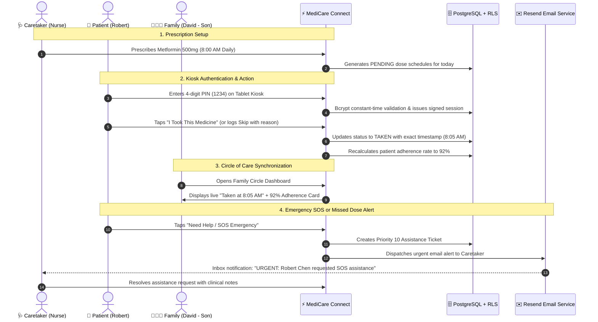

# MediCare Connect — Work Function & User Guide

> **A comprehensive operational guide explaining how MediCare Connect works, its core clinical workflows, and how each stakeholder (Patient, Caretaker, Family, Admin) uses the platform.**

---

## 1. Executive Summary & Purpose

**MediCare Connect** is a collaborative healthcare platform built to ensure elderly patients never feel abandoned in their medical decisions. It solves three critical everyday problems:
1. **Medication Forgetfulness & Non-Adherence**: Polypharmacy (taking 5+ daily pills) leads to confusion and accidental missed doses.
2. **The "Silent Skip" Problem**: Elderly patients who feel sick or nauseous often skip pills in silence. MediCare Connect requires a clinical skip reason so caregivers are immediately notified.
3. **Family Care Anxiety**: Adult children living far away often worry whether their elderly parent took their heart or diabetes medication today. MediCare Connect gives families real-time transparency.

---

## 2. Core Work Functions (How the System Operates)

The diagram below illustrates how data and actions flow through MediCare Connect:



---

## 3. The 4 Stakeholder Portals (Step-by-Step Usage)

MediCare Connect features 4 dedicated role dashboards. Here is how each role works:

---

### Portal 1: 👴 Patient Kiosk (`/patient`)
Designed specifically for shared family iPads, Android tablets, or touch monitors placed on the kitchen counter or bedside table.

- **How to Log In**:
  1. Open the app and click **"Sign In"** or navigate directly to `/login`.
  2. Select the **"Kiosk PIN"** tab.
  3. Enter the 4-digit PIN: **`1234`** (configured for demo patient *Robert Chen*).
  4. The system validates the Bcrypt hash and opens the tactile patient interface.

- **Key Features on this Screen**:
  - **Today's Medicines Card**: Shows morning, afternoon, and evening prescriptions.
  - **"I Took This Medicine" Button**: A huge, tactile 64px green button. Tapping it records the dose with a live timestamp and updates the progress indicator.
  - **"Skip / Need Help" Button**: If the patient cannot take a pill, tapping this opens the **Skip Reason Modal**. The patient selects a reason (*Nausea*, *Feeling Dizzy*, *Ran out of pills*, *Fasting*). Empty reasons are strictly rejected.
  - **Daily Habits**: One-touch checklists to mark off drinking water, taking a morning walk, or checking blood pressure.
  - **Doctor Appointments**: Displays upcoming clinic visits with a one-touch **"Acknowledge Appointment"** button.
  - **Urgent SOS Button**: A prominent red button (*"Need Help / Caretaker"*) that sends an emergency alert directly to the nurse and family.

---

### Portal 2: 🩺 Caretaker Operations Center (`/caretaker`)
Designed for professional nurses, assisted-living clinical staff, and home health aides.

- **How to Access**:
  - Open `/caretaker` (or use the sidebar *"Role Portals"* shortcut).

- **Key Features on this Screen**:
  - **Assigned Patient Roster**: View all assigned elderly patients (*Robert Chen*, *Margaret Taylor*, *Harold Kumar*) with real-time adherence percentages.
  - **Medication Management**: Caregivers can prescribe new medications, set dosage strengths (e.g., 500mg), frequencies (Once daily, Twice daily), and times of day.
  - **Clinic Appointment Scheduling**: Caregivers schedule upcoming doctor visits and track whether the patient has acknowledged them.
  - **Live Assistance Request Queue**: Review assistance calls and SOS emergency tickets. Caregivers can change tickets from `PENDING` to `RESOLVED` and record clinical care notes.

---

### Portal 3: 👨‍👩‍👦 Family Circle (`/family`)
Designed for adult sons, daughters, and relatives who want peace of mind regarding their parent's daily care.

- **How to Access**:
  - Open `/family` (or use the sidebar *"Role Portals"* shortcut).

- **Key Features on this Screen**:
  - **Daily Care Adherence Overview**: Immediate visual confirmation of today's doses (e.g., *Metformin: TAKEN at 8:05 AM*).
  - **Adherence Trend Metric**: Visual adherence score (e.g., 92%) indicating long-term consistency.
  - **Doctor Appointments**: View upcoming consultations and specialist checkups.
  - **Care Team Contacts**: Instant phone and email contact cards for the assigned primary nurse (*Nurse Sarah Jenkins*).
  - **Read-Only Safety Guard**: Family members can view everything to stay informed, but cannot accidentally delete or modify clinical prescriptions.

---

### Portal 4: 🛡️ Administrator Console (`/admin`)
Designed for clinic directors, hospital IT managers, and system administrators.

- **How to Access**:
  - Open `/admin` (or use the sidebar *"Role Portals"* shortcut).

- **Key Features on this Screen**:
  - **Patient Registry**: Enroll new elderly patients, assign their primary caretaker, and record emergency contact phone numbers.
  - **Care Circle Invitations**: Send secure email invitations to caregivers and family members.
  - **Append-Only Clinical Audit Log**: An immutable, tamper-proof audit trail displaying every system action (e.g., who took what pill, when an assistance ticket was opened, and who resolved it). Update and delete operations are rejected by database triggers.

---

## 4. Key Clinical Rules & Safety Guarantees

1. **Zero Auto-Take Policy**:
   - Doses are **never automatically marked as taken** when the scheduled time arrives.
   - If a patient does not press "I Took This Medicine", the dose remains `PENDING` and eventually transitions to `MISSED`, triggering caregiver notifications.
2. **Mandatory Skip Rationales**:
   - Patients can never skip a dose anonymously. They must declare why (*Nausea*, *Dizzy*, etc.) so clinical teams can adjust prescriptions if side effects occur.
3. **5-Attempt Brute-Force Lockout**:
   - If someone repeatedly types an incorrect PIN on the tablet kiosk, the kiosk locks down for **15 minutes** after 5 consecutive failed attempts.
4. **Row-Level Security (RLS) Isolation**:
   - Family members and caregivers can only view records for patients they are explicitly authorized to care for. Cross-patient snooping is blocked at the database engine tier.

---

## 5. How to Test the App Right Now

### Option A: Test on the Live Production URL
Visit: **[https://medibuddyxcatalyst.vercel.app/](https://medibuddyxcatalyst.vercel.app/)**

1. **Test the Patient Kiosk**:
   - Click **"Patient Demo View"** in the top navigation (or go to `/login` -> click **"Kiosk PIN"**).
   - Enter PIN: **`1234`**.
   - Tap **"I Took This Medicine"** on *Atorvastatin*. Watch the card turn green and celebrate completion!
   - Tap **"Skip / Need Help"** on another pill -> pick **"Nausea / Upset Stomach"** -> submit.
   - Tap **"Need Help / Caretaker"** to trigger an SOS alert.
2. **Test the Caretaker Portal**:
   - Click **"Caretaker"** in the bottom left sidebar navigation panel.
   - Notice the updated adherence metrics and the live assistance request queue.
3. **Test the Family Portal**:
   - Click **"Family"** in the sidebar.
   - Notice the transparent adherence log confirming that Robert Chen took his medication.
4. **Test the Admin Console**:
   - Click **"Admin"** in the sidebar.
   - Scroll down to the **Append-Only Audit Log** to see the chronological record of every dose action.

---

### Option B: Run Locally on Your Machine
```bash
# 1. Clone the repository
git clone https://github.com/2k24cs1k2412828-cloud/medibuddy_xcatalyst.git
cd medibuddy_xcatalyst

# 2. Install dependencies
npm install

# 3. Start local server
npm run dev
```
Open **`http://localhost:3000`** in your browser.

---

## 6. Summary of Key Files

| Feature Area | Source Code Location |
|---|---|
| **Patient Kiosk UI** | `src/components/patient/patient-dashboard-client.tsx` |
| **Caretaker Console** | `src/components/caretaker/caretaker-dashboard-client.tsx` |
| **Family Circle UI** | `src/components/family/family-dashboard-client.tsx` |
| **Admin Console** | `src/components/admin/admin-dashboard-client.tsx` |
| **Authentication & PIN** | `src/lib/actions/auth.actions.ts` & `src/lib/auth/kiosk-session.ts` |
| **Dose Actions Server Logic** | `src/lib/actions/medication.actions.ts` |
| **Notification Engine & Resend** | `src/lib/email/resend.service.ts` & `src/app/api/cron/process-reminders/route.ts` |
| **Database Migrations & RLS** | `supabase/migrations/001` through `009` |
